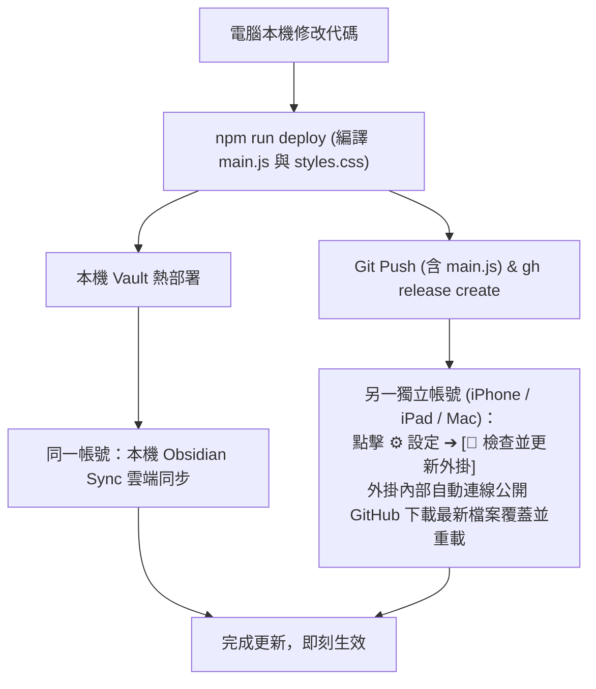

# Diary Copilot 永久專案交接與狀態日誌 (Canonical Handover & Status Record)

> [!IMPORTANT]
> **給所有接手此專案的 AI 代理人（Coding Agents）**：
> 當開啟新對話串或接手任務時，**必須優先完整閱讀本文件與 `AGENTS.md`**！
> 嚴禁脫離本文件與使用者的指示擅自猜測架構或引進外部不相容機制。

---

## 一、專案身分與環境資訊

* **專案名稱**：Obsidian Diary Copilot (`obsidian-diary-copilot`)
* **本機代碼倉庫**：`E:\obsidian-english\obsidian-diary-copilot`
* **本機 Vault 部署路徑**：`E:\AI-Knowledge-System\Obsidian-Vault\.obsidian\plugins\diary-copilot`
* **當前最新版本**：`v0.3.70`
* **使用者**：Alan（對話與說明一律使用**繁體中文**；代碼識別碼與 Commit 訊息一律使用英文）。

---

## 二、核心更新與跨裝置發布架構（最高鐵律，絕不可違背）

> [!CAUTION]
> **給所有接手此專案的 Coding Agents 的最高警告**：
> 1. 本外掛有**另一個獨立的 Obsidian 帳號**在 iPhone、iPad、Mac 等跨平台裝置上活躍使用，該帳號無法透過本機的 Obsidian Sync 獲得代碼。
> 2. 第三方社群工具（如 BRAT 外掛）連線 GitHub 下載經常不穩定且無法保證及時生效。
> 3. **因此，外掛內部必須始終具備「自行連線 GitHub 下載更新」的能力（`src/services/updater.ts`）！嚴禁擅自移除 GitHub 直連下載邏輯！**
> 4. **發布時必須同步更新 GitHub Release 實體檔案與倉庫 `main.js`，絕不可只改版本號！**

### 1. 雙軌更新閉環（Dual Update Pipeline）

### 2. 每次發布版本的標準閉環三步驟（Mandatory Release Protocol）
每次版本遞增（無論是大版更或小修復），代理人**必須且只能**嚴格依序執行：
1. **編譯與熱部署**：
   執行 `npm run deploy`，確保本地輸出最新 `main.js`、`styles.css`、`manifest.json`。
2. **Git 倉庫推送（必須包含 `main.js`）**：
   `git add -A && git commit -m "..." && git push origin main`
   （`.gitignore` 絕對不可忽略 `main.js`，確保 GitHub `main` 分支隨時可作為 Raw CDN 備援下載）。
3. **發布 GitHub Release 實體資產**：
   執行 `gh release create vX.Y.Z main.js manifest.json styles.css --title "..." --notes "..."`
   （確保 GitHub Releases 頁面具備實體二進位檔案，供所有跨帳號之 iPhone/iPad/Mac 自主下載更新）。

---

## 三、目前版本（v0.3.40）核心功能狀態清單

### 1. 自動展開字卡（Auto-Expand Cards）
* **✨ 潤飾（Polish）**：
  * 使用者點擊「✨ 潤飾」時，在 `setLoading()` 階段即自動收合鍵盤、重設手動尺寸鎖定，並在 `applyPanelHeight()` 加入 `!is-loading` 保護，面板直接展開至 390px / 55% 視窗高度，避免縮回 60px。
  * 潤飾完成後先執行 `renderBrowseMode()` 建立卡片群組，隨即自動呼叫 `openCards()`，4 張地道潤飾卡片直接呈現在眼前，無需額外點擊。
  * 點擊「✨ 潤飾」時自動清除先前可能暫留的引導提問條，避免介面衝突。
* **❓ 引導提問（Inquiry）**：
  * 修改 `setPinnedInquiry()`，預設將 `isShowingInquiryAnswers = true`。
  * 使用者點擊「❓ 提問」後，除了固定呈現上方問題條外，下方自動呈現 4 張結構化建議回答字卡（Yes 1/2, No 1/2 或 Open 1/2/3/4），完全不需要使用者手動點擊「💡 查看建議回答」。
  * 右側切換按鈕同步調整為「✍️ 收起建議回答」，點擊可暫時收起查看即時打字續寫。

### 2. 手機語音跟讀與套用（Oral Shadowing & Adoption）
* **失焦問題徹底修復**：`src/main.ts` 新增 `getActiveMarkdownView()`，具備三層防禦 Fallback（標準 `MarkdownView` → DOM 連線快取 `this.activeView` → 工作區 `leaves`），徹底解決手機跟讀時編輯器 blur 導致無法找到編輯器實例的 bug。
* **方案 3 雙軌感知策略（Dual-Context Aware Snap）**：新增 `resolveDualContextSnap()`，在無游標或鍵盤收起狀態下，自動向後吸附至整句標點（`. ! ? 。 ！？`）或單詞邊界（Anti-fragment），並自動進行前綴/後綴空格檢查（Anti-glue），確保插入文字不黏詞、不碎詞。
* **跟讀成功後自動套用**：`executeOralAdoption()` 統一呼叫 `adoptSuggestion(..., "oral")`，70%+ 跟讀成功自動將標準句子套入筆記。
* **行為 A 自動收合**：套用成功後，手機版字卡自動收合為 60px 底部功能列，讓出完整畫面給使用者繼續檢閱或打字。

### 3. 外掛內部資料夾更新偵測（Folder-Based Updater）
* `src/services/updater.ts` 徹底移除對 GitHub 網路請求的依賴。
* 讀取本機 `${app.vault.configDir}/plugins/diary-copilot/manifest.json`：
  * 若資料夾版本 > 記憶體版本（Obsidian Sync 同步了新版）：彈出通知並在 700ms 後執行 `window.location.reload()`。
  * 若使用者手動按下更新鈕：同樣安全重載視窗，確保剛同步進硬碟的最新代碼瞬間生效。

---

## 四、永久開發規範（AGENTS.md 最高守則）

1. **嚴禁更動非目標程式碼（Strict Scope Boundary）**：
   * 最小變更原則（Minimal Blast Radius）：每次修改程式碼，僅限於使用者明確指定修復或調整的功能。
   * 絕對禁止「順帶重構」、「擅自改寫」原本運作正常的樣式、邏輯與佈局。
2. **層級隔離原則（內容歸內容，容器歸容器）**：
   * 隱藏內容只能針對內容子元素（`.diary-copilot-hero-card`, `.diary-copilot-capsule-tabs`）。
   * 絕對禁止在父容器（`.diary-copilot-panel`）上施加破壞性覆蓋（如 `overflow: hidden !important`）。
3. **介面契約永不退化**：
   * 頂部手柄（`top: -24px`）必須保持完全可見、可觸控，面板容器保持 `overflow: visible !important`。
   * 底部安全觸控邊距（`calc(60px + env(safe-area-inset-bottom, 0px))`）絕對不可壓平。
4. **創意思考必先評估影響、先徵詢同意（Propose Before Action）**：
   * 若發現更好的架構設計，嚴禁直接寫入代碼，必須先說明出發點與正反影響，待 Alan 同意後方可著手。

---

## 五、版本修訂紀錄 (Changelog)

| 版本 | 日期 | 重點改動說明 |
| :--- | :--- | :--- |
| **v0.3.70** | 2026-11-19 | 1. 徹底根除 Mac / Windows 按下 ESC 鍵時觸發的作業系統語音聽寫二次重複寫入： - 診斷原因：在 Mac 系統中，Apple Dictation（連按兩次 Fn）在結束時可由 `Enter` 或 `Escape` 鍵提交。在跟讀達標句子自動貼入筆記後，若使用者按下 `ESC` 想關閉浮窗或解除聚焦，macOS / Windows 聽寫緩衝區會將未關閉的聽寫結果再次提交至筆記，導致與 Enter 鍵一模一樣的二次複製 Bug。 - 防護 1（全局 Escape 事件安全攔截）：在全域鍵盤監聽中優先偵測 `isOralActive()`，若跟讀進行中按 ESC，立即主動中斷語音、清空並模糊 `desktopVoiceInputEl`，絕不讓 OS 聽寫引擎殘留緩衝。 - 防護 2（延遲編輯器聚焦）：跟讀自動填入完成後，稍作延遲 300ms 再將焦點交給 Obsidian 編輯器，確保 OS 聽寫 session 完全安全退場，杜絕游標轉移造成的跨視窗沖刷。 - 防護 3（交易層擴展至 6 秒全面阻絕 Enter 與 ESC 沖刷）：智慧重複句子消除器攔截窗口升級至 6000ms，無論使用者按 Enter（帶換行）或 ESC（不帶換行），只要出現重複句子一律在 CodeMirror 交易底層原地抹除！ 2. 專案版本升級為 v0.3.70。 |
| **v0.3.69** | 2026-11-19 | 1. 深度根除 Mac / Windows / iOS 原生語音聽寫在 Enter 鍵時的二次沖刷寫入（IME / Dictation Flush Eliminator）： - 診斷原因：在 Mac（連按兩次 Fn）或 Windows（Win+H）進行語音跟讀時，當吻合度達標自動貼入筆記後，作業系統的聽寫引擎（Apple Dictation）依然在背景維持未提交的緩衝 session。當使用者在輸入框或編輯區按下 `Enter` 換行時，Electron 與 macOS 聽寫引擎會強制將未完成的緩衝文字再次沖刷（flush）輸出至當前焦點編輯器，導致編輯區瞬間出現兩句一模一樣的句子！ - 防護 1（即時離焦與輸入框乾淨清空）：在跟讀判定達標瞬間與按下 Enter 瞬間，立即對 `desktopVoiceInputEl` 執行 `blur()` 與 `value = ""`，主動通知 OS 聽寫引擎結束 session，阻止緩衝轉移。 - 防護 2（CodeMirror 核心交易層智慧攔截消除）：在 `handleEditorUpdate` 中攔截任何在套用後 4000ms 內由 Enter 或 OS 沖刷進來的重複句子（比對正規化文字），一旦發現重複立即自動撤銷該句並僅保留使用者想要的換行 `\n`，徹底在編輯器層面阻斷重複寫入，全平台（Mac, Windows, iPhone, iPad, Android）徹底絕收！ 2. 專案版本升級為 v0.3.69。 |
| **v0.3.68** | 2026-11-18 | 1. 徹底杜絕 Mac / iOS / 跨平台口說跟讀重複貼入（Triple-layer Anti-duplicate Guard）： - 診斷原因：在 Mac / Desktop / iOS 裝置上，若語音聽寫達標或點擊「⏹️ 說完了」時，450ms 動畫延遲結算與重複點擊/Enter 可能觸發兩次結算；且提問模式下建議回答誤帶入先前的 `currentItem?.sourceRange` 舊區間；外加 `onOralShadowComplete` 與 `onOralAdopt` 缺乏同步互斥保護。 - 防護 1（CardPanel 防重入狀態鎖）：`handleOralPass`、`finishOralRecording`、`handleOralAdoptDirect` 全面增設 `if (this.oralPassed) return;` 阻斷防護，並在任一入口觸發時立即清除 `oralPassTimeout` 與 `autoPassTimer`，徹底杜絕 450ms 延遲期間的二次觸發。 - 防護 2（提問模式 Range 純化）：提問模式下的建議回答均為新段落，強制將 `sourceRange` 置為 `undefined`，絕不殘留舊潤飾句子的定位區間。 - 防護 3（全域原子冪等擴大至 2500ms）：將直接貼入的防重複窗口擴展至 2.5 秒，且 `onOralShadowComplete` 與 `adoptSuggestion` 共享統一時間戳防禦，徹底杜絕任何系統層級的雙重寫入。 2. 專案版本升級為 v0.3.68。 |
| **v0.3.67** | 2026-11-18 | 1. 提問模式「收起建議回答 ⇄ 查看建議回答」按鈕真實生效（徹底消除殘留卡片干擾）： - 診斷原因：先前點擊「收起建議回答」時，面板僅切換 `isShowingInquiryAnswers = false`，但在 `renderBrowseMode` 中仍有 `else if (item)` 分支，導致系統掉入先前的 `this.currentItem` 舊潤飾字卡，造成按鈕雖然寫「查看建議回答」，下方卻依然常駐 4 張舊字卡，無法真正收摺。 - 真實收起與高度自適應（Clean Collapse & Auto-fit）：收起狀態下明確將 `currentCards` 置空，並移除多餘的佔位區塊，讓面板高度立即自動收縮至只保留「提問條」與「頂部功能列」（約 70~80px），徹底騰出筆記主編輯區視野供使用者自由作答；點擊「💡 查看建議回答」則精準展開 4 張建議回答卡片並自然撐開高度。 - 雙向聯動同步：頂部工具列 `F6`（展開/關閉字卡）在提問模式下與「查看/收起建議回答」保持 100% 雙向狀態聯動同步。 2. 專案版本升級為 v0.3.67。 |
| **v0.3.66** | 2026-11-18 | 1. 查詞懸浮窗詞性標籤（`popover-pos`）嚴格鎖定保留（絕不遺失）： - 確保反白查詞懸浮窗在擁有 `🔊` 發音按鈕的同時，單字詞性標記（如 `n.`、`v.`、`phr.`）100% 絕對保留於單字後方，若為多詞片語且 API 未回傳詞性時自動備援標記 `phr.`。 2. 整篇整理「初稿盲點替換紀錄」大幅精煉去重（聚焦單字/片語/慣用語新表達）： - 診斷原因：先前多次點擊「✨ 整理跟讀」時，筆記中原有的 `### 💡 口說與寫作初稿盲點替換紀錄` 會被當作初稿重複讀取，造成每次重新整理時盲點紀錄指數堆疊，且直接倒出完整大段落與整句，失去了提煉核心表達的價值。 - 徹底剔除舊紀錄：讀取初稿時自動透過正則表達式剔除任何先前的盲點或表達升級區塊，杜絕二次整理堆疊。 - 精煉單字/片語升級（Expression Upgrades）：提示詞與資料結構升級為 `upgrades` 欄位，由 AI 提煉 1~4 項精確「單字、片語、慣用語」（`初稿表達 ➔ 升級表達 (中文釋義)`），徹底告別整段冗長重複，聚焦於道地新表達的發現與吸收！ 3. 專案版本升級為 v0.3.66。 |
| **v0.3.65** | 2026-11-18 | 1. 反白即時查詞懸浮窗（SelectionPopover）補齊 `🔊` 語音朗讀發音功能： - 診斷原因：反白查詞浮窗先前僅呈現單字、詞性、簡明翻譯與關閉鈕，缺少發音按鈕，使用者反白生字時無法即時聽取聽覺語音。 - 雙重發音入口（Dual Pronunciation Trigger）：   1. 右側操作區新增 `[🔊]` 獨立發音按鈕，點擊立即透過 Google TTS 串流輸出標準美音發音。   2. 單字標籤本體（`.popover-term`）亦支援點擊發音與游標懸浮提示，隨心點按即播。 2. 專案版本升級為 v0.3.65。 |
| **v0.3.64** | 2026-11-18 | 1. 避開輸入法快捷鍵衝突：展開/關閉字卡快捷鍵由 `F4` 轉移至 `F6`： - 診斷原因：使用者反饋 `F4` 在中文輸入法（如注音/拼音）為原生功能鍵，容易產生攔截衝突。 - F6 完美避障：將字卡展開/收摺快捷鍵改為 `F6`（位於 `F5 提問引導` 緊鄰右側），單鍵直覺、毫不衝突。 - 頂部快捷操作鍵一覽：   - `F3`：✨ 潤飾當前/前一句   - `F5`：❓ 提問引導模式   - `F6`：**展開 ⇄ 關閉字卡** - 桌面端按鈕動態提示同步更新為 `🔽 關閉字卡 (F6)` 與 `📖 展開字卡 (F6)`。 - Obsidian 命令面板更新為：「展開／關閉建議字卡 (F6)」。 2. 專案版本升級為 v0.3.64。 |
| **v0.3.63** | 2026-11-18 | 1. 確立快捷鍵職責單一化：`F4` 專責展開/關閉字卡，`Esc` 完整回歸取消灰字與關閉彈窗（方案 A）： - 診斷原因：使用者發現 `Esc` 在英文寫作過程中具有「取消當前灰字跟寫（Dismiss Ghost Text）」的重要直覺職責。先前若將 `Esc` 作為收摺/展開開關，想單純放棄灰字時會意外收起整組字卡。且單按 `Ctrl` 存在輸入法中英切換、快速鍵誤觸與跨平台鍵位差異。 - F3/F4/F5 一體化頂部快捷操作鏈：   - `F3`：✨ 潤飾當前/前一句   - `F4`：**展開 ⇄ 關閉字卡**（CodeMirror 編輯器內與全域 window 均支援）   - `F5`：❓ 提問引導模式 - Esc 職責回歸：按下 `Esc` 僅專注於取消灰字、關閉查詞懸浮窗與關閉系統 Modal，不再收合字卡面板。 - 桌面端按鈕動態提示同步升級為 `🔽 關閉字卡 (F4)` 與 `📖 展開字卡 (F4)`。 - 新增 Obsidian 原生指令：「展開／關閉建議字卡 (F4)」。 2. 專案版本升級為 v0.3.63。 |
| **v0.3.62** | 2026-11-18 | 1. 電腦端排版重整：按鈕從最左側起始排列，模式提醒移至按鈕右側（徹底根除字串長度造成的按鈕抖動）： - 診斷原因：先前模式提醒（`● Diary Copilot` 與 `● ❓ 提問引導模式`）位於 `[📅 今日日記]` 的左邊，由於兩者字元長度不同，在開啟/關閉提問模式時，寬度變化約 35px 會導致其右邊的所有按鈕產生位移抖動。 - 電腦端絕對固定（Desktop Anchor Left）：桌面端將功能按鈕群（`headerSysEl`）設定為 `order: 1` 靠最左起排，起點永遠從 x=0 鎖定；模式提醒（`brandWrapperEl`）設定為 `order: 2` 移至按鈕群右側。文字長度不論如何變化，均只在右側留白區伸展，左側所有功能按鈕位置 100% 絕對固定、零跳動。 2. 手機與平板維持從右到左（Right-to-left Thumb Ergonomics）與靈活自適應： - 行動端（手機與平板）保留從右至左的靠右排列（`order: 2; justify-content: flex-end`），方便大拇指單手舒適點擊。 - 自適應精簡文字（`📅`、`✨ 整理`、`⚙️`）與平滑橫向滑動保護維持 100% 原生穩定。 3. 專案版本升級為 v0.3.62。 |
| **v0.3.61** | 2026-11-18 | 1. 功能列按鈕一律自左側品牌/模式指示旁緊接排列（徹底杜絕左右橫跳與狀態列碰撞）： - 診斷原因：先前在收摺模式（`is-cards-closed` / `is-collapsed` / `is-compact-idle`）時，CSS 套用了 `justify-content: space-between` 與 `justify-content: flex-end`，將功能列按鈕推至畫面最右側（與 Obsidian 狀態列重疊）；而展開字卡時按鈕又回彈到左側，導致使用者按 Esc 切換或開關字卡時「功能列在左側與最右側之間劇烈橫跳」。 - 左側緊密排列（Left-anchored Functional Toolbar）：修改 CSS 與佈局規則，頂部功能列（`row-1` 與 `header-sys`）在任何狀態（展開/收摺/提問/潤飾/精簡）下，一律維持 `justify-content: flex-start`，按鈕緊鄰左側的品牌指示（`● Diary Copilot` 或 `● ❓ 提問引導模式`）由左至右平鋪排列。 - 模式指示一致性：收摺狀態下若處於提問模式，左側依然維持顯示 `● ❓ 提問引導模式`，不再跳回 `Diary Copilot`，確保按鈕起始位置 100% 絕對穩定，切換字卡零跳動。 2. 展開字卡確保顯示完整卡片內容（Auto-fit & Full Visibility）： - 在提問引導模式下按 Esc 展開時，自動確保建議回答處於展開渲染狀態（`isShowingInquiryAnswers = true`），確保 4 張建議字卡完全呈現且看得清清楚楚。 3. 專案版本升級為 v0.3.61。 |
| **v0.3.60** | 2026-11-18 | 1. Windows 與 Mac 支援按下 Esc 鍵作為展開/關閉字卡的切換開關（Esc Toggle）： - 診斷與重構：原先鍵盤監聽中 Esc 鍵僅用於解除灰字跟寫，未與底部建議字卡開關聯動。 - Esc 雙向切換（Toggle）：按下 Esc 鍵時，若有 Obsidian 原生彈窗（`.modal-container`）則維持原生關閉；若有查詞浮窗（SelectionPopover）則優先收合；其餘情況若有灰字則一併清理，並立即觸發 `cardPanel.toggleFoldCards()`，在「展開字卡」與「關閉字卡」之間流暢切換！ - 電腦端按鈕標籤提示：桌面端（Windows / Mac）的字卡切換按鈕文字與提示動態升級為 `🔽 關閉字卡 (Esc)` 與 `📖 展開字卡 (Esc)`。 - 設定選單 Esc 事件隔離：在快速設定選單按下 Esc 關閉時加上 `stopPropagation()`，避免事件冒泡觸發字卡切換。 2. 專案版本升級為 v0.3.60。 |
| **v0.3.59** | 2026-11-18 | 1. 電腦端排版解放：字卡寬度滿版對齊、高度自然縮減（徹底消除右側黑邊）： - 診斷原因：早期版本為了避讓 Obsidian 右下角狀態列（.status-bar），在桌面端面板被硬性加上了高達 320px~360px 的 `padding-right`，導致電腦端 2x2 網格被強行擠壓在左側 70% 空間，右側出現大片黑色死區，且因為每張卡變窄，英文句子折成 5-6 行讓字卡被撐得非常高，大幅遮擋上方的編輯區。 - 滿版對齊（Full-Width Balanced Alignment）：移除桌面端壓迫性的 `padding-right: 320px` 限制，面板內距回歸純淨平衡的 `padding: 6px 14px 8px`。 - 空間效益最大化：2x2 網格字卡與提問條隨即自然向右展開對齊版面，單行能容納更多單字，句子折行減少至 2-3 行，字卡垂直高度大幅壓縮，真正做到「字卡更寬、更氣派、向上遮蔽最少」！ 2. 專案版本升級為 v0.3.59。 |
| **v0.3.58** | 2026-11-18 | 1. 實現方案 2：支援單個 `#` 標題分段沉浸跟讀（Section-based Shadowing）： - 漸進浮現設計（Progressive Disclosure）：若日記只有一篇無標題文字，介面 100% 保持原樣（零干擾）；若偵測到 2 個以上 `# 標題`，跟讀彈窗頂部自動浮現橫向標籤列：`[ 📖 全部 (X句) ] [ # 標題1 (Y句) ] [ # 標題2 (Z句) ]`。 - 即時無縫切換（Instant Section Switch）：點選任一標籤，提詞機立即切換至該章節句子並從 1 重新編號，進度條同步重置，朗讀專注於該章節，讀完提示章節完成，亦可隨時切回全部，零刷新零重開。 - 筆記檔案零風險（Zero Mutation）：純記憶體分段，完全不改動任何 Markdown 檔案，無資料覆蓋遺失風險。 - 保留 `#` 標題解析：調整 `handleFullTextShadowing`，不再預先剔除 `#` 標題，完整將標題章節結構傳遞至跟讀彈窗。 2. 專案版本升級為 v0.3.58。 |
| **v0.3.57** | 2026-11-18 | 1. 全裝置、全平台全面回歸與相容性強化（Zero-Regression Compatibility Pass）： - 多層目錄自動遞迴建立（`ensureFolderExists`）：修復 `openTodayDiary` 在日記資料夾為多層路徑（如 `Personal/English/Diary`）時因父目錄不存在可能失敗的問題。 - WebKit / Chromium 語音合成垃圾回收保護（Utterance GC Guard）：在離線備援 `speechSynthesis` 中維持全域 `activeUtterance` 參照與 `stopAudio` 乾淨釋放，根治 WebKit 朗讀到一半被 GC 中斷且不觸發 `onend` 的核心問題。 - 嚴格遵守零破壞原則：未更動任何既有功能介面契約（字卡雙平台三合一按鈕、灰字跟寫、潤飾提問自動展開、整理跟讀全流程維持 100% 穩定相容）。 2. 專案版本升級為 v0.3.57。 |
| **v0.3.56** | 2026-11-18 | 1. 深度除錯：根治斷句邏輯、音訊非同步懸掛與跟讀競態 Bug： - 智慧句子切分器升級（Sentence Tokenizer Protection）：原先正規表達式 `[^.!?\n]+[.!?]+` 會誤將小數點數字（如 `v0.3.52`、`3.14`）、時間（`8:30 to 3:00`）與縮寫（`e.g.`、`Dr.`）截斷並丟失單字；升級為語意邊界切分器，保護小數點與縮寫完整性。 - Web Audio 非同步懸掛防護（Resume Timeout Race）：在 `playWithAudioContext` 中為 `ctx.resume()` 加入 800ms 逾時競態機制，若 iOS 系統因未持手勢而掛起 Promise，立即超時拋出並自動無縫由 HTMLAudioElement 備援播放，徹底杜絕懸掛卡死。 - 音訊緩衝區聲道邊界保護：`concatenateAudioBuffers` 新增 `buffers.length === 0` 保護與動態聲道對齊（避免單聲道與雙聲道混接時索引越界）。 - 全篇跟讀紀元追蹤保護（Playback Epoch Protection）：`FullTextShadowingModal` 導入 `playSessionId`，無論暫停、重播、任意點擊跳句或關閉彈窗，立即遞增 session ID，徹底消除上一句音訊非同步回呼造成的並發競態與跳句問題。 - AI 整理 JSON 邊界提取強化：`tidyUpTodayDiary` 加入 `{[\s\S]*\}` 外層比對，避免模型前綴說明文字導致 `JSON.parse` 報錯。 2. 專案版本升級為 v0.3.56。 |
| **v0.3.55** | 2026-11-18 | 1. 深度強化 iPhone / iPad (iOS WebKit / WKWebView) 跨平台穩定度： - Web Audio API (AudioContext) 音訊核心升級：針對 iOS Safari / WKWebView 對非同步連續音訊（Autoplay Policy）的嚴格限制，將 TTS 核心升級為 `AudioContext` + 原生 PCM Buffer 拼接。使用者於點擊「▶️ 開始朗讀跟讀」時即主動解鎖 `unlockAudio()`，後續多個句子在 `setTimeout` 連續播放時直接透過 AudioContext PCM 串流輸出，徹底杜絕 iOS `NotAllowedError` 與 Blob URL 在 `app://` 自訂協定下解碼失敗的問題。 - 多層回退保護：AudioContext ➔ 重複使用之 sharedAudio ➔ 系統原生 SpeechSynthesis。 - iOS 人體工學與底部安全邊界修復：跟讀彈窗底部加入 `env(safe-area-inset-bottom)` 安全避讓 iPhone Home Indicator；按鈕網格由 `1fr 1fr 1.25fr` 精準重設為 `1fr 1fr 1fr` 等寬，小螢幕完美對齊。 - iPad 大螢幕與外接鍵盤全面驗證：寬度 >= 640px 自動啟用 2x2 完整網格；窄分屏（Split View 1/3）自動自適應為單卡膠囊分頁；外接鍵盤 Option+1~4 鍵盤事件相容。 2. 專案版本升級為 v0.3.55。 |
| **v0.3.54** | 2026-11-18 | 1. 徹底拔除全篇跟讀對筆記 Frontmatter 的寫入紀錄（落實極簡純粹書寫）： - 診斷原因：跟讀完成後的 `oral_shadowed` 與 `shadowed_at` 不僅無法為語言習得提供實質教學介入，反而製造了視覺噪音；且原先 Regex 替換存在 non-greedy 缺陷導致時間戳字串反覆串接堆疊成亂碼。 - 徹底拔除：刪除 `recordShadowingCompleted` 方法，跟讀彈窗結束按鈕精簡為「✅ 結束跟讀」，完成時僅於介面給予即時完成提示，100% 絕不更動、不污染使用者的筆記 Markdown 檔案。 2. 專案版本升級為 v0.3.54。 |
| **v0.3.53** | 2026-11-18 | 1. 徹底重構高品質 TTS 語音朗讀核心（解決全篇跟讀頻繁跳句與播放失敗）： - 診斷原因：原本的第三方 TTS 引擎 `ttsmp3.com` 具備每日 3,000 字元免費額度限制，超額時回傳 `{"Error":"Usage Limit exceeded"}`；第二備援 `dict.youdao.com` 對超過 60 字元的長句回傳 HTTP 500 錯誤；且 `FullTextShadowingModal` 在播放報錯時誤觸 `onEnd()` 回呼，導致連續快轉跳句並觸發滿屏「語音朗讀播放失敗」Notice 彈窗。 - 多層容錯升級（Multi-layer Architecture）：全面升級以 Google 官方即時美音 TTS 串流引擎（`gtx` & `tw-ob`）為第一與第二主引擎，無字數與呼叫次數限制，零延遲高速直傳。 - 長句自然切句與無縫 MP3 Buffer 串接（Seamless Chunk Concatenation）：針對超過 160 字元的長句，自動以標點符號與子句自然切分，平行下載後在記憶體內直接將音訊 ArrayBuffer 串接為單一完整的 MP3 Blob URL，播放完全無縫、零間隙。 - 播放失敗保護機制：`FullTextShadowingModal` 接入 `onError` 防護，當網路異常導致音訊無法播放時，自動原地暫停並保留當前句子高亮，僅跳出一次通知，徹底杜絕骨牌效應式的跳句。 2. 專案版本升級為 v0.3.53。 |
| **v0.3.52** | 2026-11-18 | 1. 徹底根除點擊字卡灰字後接著跟讀的「雙重寫入競態重複（Double Adoption Race Collision）」： - 診斷原因：點字卡啟動了 `Scheduler` 的鍵盤語音影子跟寫監聽器，隨後開啟 `CardPanel` 跟讀工作台時未清除狀態；使用者說話時兩套系統在 23ms 內相繼判定達標並重複寫入文檔同一個位置。 - 防護 1（狀態隔離）：點擊進入口說跟讀工作台（`startOralShadowing`）時，立即強制呼叫 `onOralStart` 清除 Scheduler 影子狀態與灰字，讓口說跟讀工作台獨佔語音結算權。 - 防護 2（執行互斥）：`onOralShadowComplete` 嚴格檢查 `isOralActive()`，跟讀進行中直接跳過，絕不重複派發。 - 防護 3（原子冪等性保護）：在 `adoptSuggestion` 內建 1500ms 重複寫入攔截防護（Atomic Idempotency Guard），杜絕任何毫秒級重複寫入。 2. 專案版本升級為 v0.3.52。 |
| **v0.3.51** | 2026-11-18 | 1. 頂部功能列新增「📅 今日日記」快捷按鈕： - 寬螢幕 / 電腦版顯示 `📅 今日日記`，手機 / 窄螢幕自適應精煉顯示 `📅`。 - 採用清爽高對比翡翠綠（Emerald Green）配色，點擊立即呼叫 `openTodayDiary`，一鍵自動開啟或建立乾淨無冗餘標題的今日日記。 2. 專案版本升級為 v0.3.51。 |
| **v0.3.50** | 2026-11-18 | 1. 開啟今日日記不再於內文自動產生 `# 當天日期` 標題： - 檢視 `src/commands/openToday.ts`，確認原始設定在建立日記新檔案時會自動注入 `# ${todayStr}`。 - 依照指示移除此標題，保留簡潔的 YAML Frontmatter（title, date, created, type: english-diary），讓使用者能直接從乾淨的空白內文開始書寫，不再有冗餘標題干擾。 2. 專案版本升級為 v0.3.50。 |
| **v0.3.49** | 2026-11-18 | 1. 徹底消除電腦端頂部重複的「朗讀、跟讀、填入」按鈕： - 由於每張字卡內部已皆擁有專屬的 `[ 🔊 朗讀 ] [ 🎙️ 跟讀 ] [ ⚡ 自動填入 ]`，頂部工具列第二排（Row 2）在瀏覽模式下一律隱藏。 - 頂部工具列全面恢復極致純淨，僅保留核心功能鈕（整理跟讀、提問、潤飾、關閉字卡、設定、關閉），徹底消除與字卡內部的按鈕重複。 2. 專案版本升級為 v0.3.49。 |
| **v0.3.48** | 2026-11-18 | 1. 全平台字卡操作行為高度一致化（電腦、平板、手機統一標準）： - 所有字卡（無論桌面端 2x2 網格或行動端單卡）內部一律具備三個獨立操作按鈕：`[ 🔊 朗讀 ]`（標準 TTS 發音）、`[ 🎙️ 跟讀 ]`（啟動即時口說判定工作台）、`[ ⚡ 自動填入 / ⚡ 填入替換 ]`（直接寫入筆記）。 - 點選字卡本體不再直接自動替換文件，而是觸發「填入灰字（影子跟寫練習）」！ 2. 恢復手機與平板端的「Alt+1~4 / 填入灰字」跟寫功能： - 解除行動端強制直接填入（Direct Paste）限制，在手機、平板與桌面端一致支援灰字跟寫練習。 - 字卡標題列在全平台（包含手機與平板外接鍵盤使用者）恢復呈現快捷鍵提示（如 `Alt+1` ~ `Alt+4`）。 3. 跟讀模式人體工學大按鈕升級（Thumb-friendly Ergonomics）： - 在語音跟讀工作台（Oral Studio）內部新增底置大尺寸操作區塊（`.diary-copilot-oral-dock-controls`），包含「🔊 聽示範」、「⏹️ 說完了 / 🔄 重試」、「⚡ 直接填入」、「✕ 取消」。 - 按鈕高度全面設定為 42px～44px，具備舒適的點擊熱區與清晰文字，在手機單手操作下絕不卡手、誤觸或太小。 4. 專案版本升級為 v0.3.48。 |
| **v0.3.47** | 2026-11-18 | 1. 整理後跟讀雙介面（ShadowingPrepModal ＆ FullTextShadowingModal）雙指縮放字級： - 支援行動端雙指捏合/張開（Pinch-to-zoom）手勢與桌面端 Ctrl+滾輪手勢，字級在 12px～32px 自由即時無段縮放。 - 放大後文字自動折行（Auto Word-Wrap）：單行容納不下時自然向下折成多行，排版絕不破圖或被右側截斷。 - 縮放時即時浮現字級懸浮提示（🔤 18px），縮放結束後自動記憶偏好至設定。 - 單指滑動不受任何干擾，平滑滾動瀏覽維持 100% 流暢原生體驗。 2. 專案版本升級為 v0.3.47。 |
| **v0.3.46** | 2026-11-18 | 1. 手機端與窄螢幕工具列極致簡化適配： - 在手機版或窄螢幕時，工具列按鈕自動轉為精煉文字：✨ 整理、❓ 提問、✨ 潤飾、📖 展開 / 🔽 關閉、⚙️（純齒輪圖示）、✕。 - 總寬度縮減至 ~260px，在任何常見手機螢幕（360px~430px）皆能一整排完整呈現，絕不擠壓或截斷。 2. 橫向平滑滑動（Horizontal Scrollable Fallback）： - 頂部工具列加入 `overflow-x: auto; -webkit-overflow-scrolling: touch; scrollbar-width: none;`。 - 即使使用者將字級放大或在超窄螢幕（< 320px）下，手指輕輕左右滑動即可順暢操作所有功能按鈕。 3. 專案版本升級為 v0.3.46。 |
| **v0.3.45** | 2026-11-18 | 1. ⚙️ 設定選單新增「🎯 英文難度（GEPT 全民英檢）」： - 支援四大級別：🌱 初級 (國中程度 / A2)、🌿 中級 (高中程度 / B1)、🌳 中高級 (大學程度 / B2)、👑 高級 (專業流利 / C1)。 - 排版完全符合純垂直上下捲動規格，單選即時生效並以 Notice 提示。 2. 全模組精準深度適配： - 系統 Prompts 核心新增 `getLevelInstructions(level)`，提供清晰的單字量（2200/5000/8000+）、句構複雜度、修辭目標與語調指導。 - 全面貫徹適用於：✨ 整理後跟讀（TidyUp）、✨ 句子潤飾（Polish）、❓ 引導提問與建議回答（Inquiry）、✍️ 即時字卡（Suggestions）、🎙️ 語音口說潤飾（VoiceRefine）。 3. 修復 `CardPanel` 預設層級回退錯誤（`"B1"` → `"upper-intermediate"`）。 4. 專案版本升級為 v0.3.45。 |
| **v0.3.44** | 2026-11-18 | 1. 全篇沉浸影子跟讀（Full-Text Shadowing）彈窗介面徹底重構與修復： - 底欄控制區隔離於獨立 Dock，配合 `flex-shrink: 0` 永遠固定於彈窗底端，徹底杜絕懸浮覆蓋文字。 - 提詞機滾動區域改為 `flex: 1 1 auto; min-height: 0; overflow-y: auto;`，句子平滑捲動，閱讀與跟讀毫不受擋。 - 句子卡片文字設定 `min-width: 0; width: 0; word-break: break-word;`，修復右側單字被截斷的問題。 - 頂部標題列加入安全右邊距（44px），避讓 Obsidian 原生 `✕` 關閉按鈕，語速選項不再重疊。 - 手機與平板人體工學觸控適配：在螢幕寬度小於 768px 時，控制列自動轉為直列結構，「▶️ 開始朗讀跟讀」按鈕放大為 46px 滿版大拇指觸控熱區，次要按鈕等寬平鋪，單手操作舒適防誤觸。 2. 專案版本升級為 v0.3.44。 |
| **v0.3.43** | 2026-11-18 | 1. 徹底解決桌面端狀態列遮蔽問題：自動量測 Obsidian 狀態列寬度並套用安全間距（`padding-right`），工具列按鈕不再與字數統計/同步圖示重疊。 2. 工具列配色高對比度全面重構：整理跟讀（亮紫/白）、提問（清澈天藍）、潤飾（明亮暖金）、展開/設定按鈕對比全面提升，黑底白字清晰銳利。 3. 關閉提問提示文字由「回續寫」修正為「關閉提問」。 4. 專案版本升級為 v0.3.43。 |
| **v0.3.42** | 2026-11-18 | 1. 方案 1 全面落實：徹底拔除打字被動即時續寫，保留「✨ 潤飾」、「❓ 提問」、「✨ 整理跟讀」與「Alt+1~4」鍵盤快捷鍵。 2. 工具列字級聯動放大：解開按鈕 12px 鎖死，底部工具列字級隨設定等比例同步縮放。 3. 收摺高度真實生效：解開 CSS 與運算限制，支援設定至 100px 或更高，工具列依設定數值等高垂直居中展開。 4. 設定選單全面改為純上下縱向捲動（垂直列表排版），徹底移除左右捲動與左右排版。 5. 專案版本升級為 v0.3.42。 |
| **v0.3.41** | 2026-11-18 | 1. 頂部更新鈕改為「⚙️ 設定鈕」，點擊彈出上拉選單（Bottom Sheet）。 2. 上拉選單整合：🚀 檢查與重載外掛、🎭 寫作風格切換（社科學術、漢學、自然、內省等風格）、📐 收摺後高度設定（48/60/72/84px）、🔤 卡片字級大小設定（即時縮放）。 3. 設定支援本地獨立記憶與即時生效。 4. 專案版本升級為 v0.3.41。 |
| **v0.3.40** | 2026-11-18 | 1. 點擊潤飾/提問時自動展開字卡（提問預設展開 4 張建議回答）。 2. 修復手機失焦導致語音跟讀無法自動套入筆記問題。 3. 落實方案 3 雙軌感知定位與防黏詞。 4. 更新機制改為偵測 Plugin 資料夾同步狀態並安全重載（擺脫 GitHub 依賴）。 |
| **v0.3.39** | 2026-11-18 | 手指滑動檢閱保持字卡展示，僅在游標落入/鍵盤升起時自動收合。 |
| **v0.3.38** | 2026-11-18 | 還原頂部手柄與手機底部人體工學安全間距，確立 AGENTS.md 守則。 |
| **v0.3.37** | 2026-11-18 | 「整篇跟讀」升級為「✨ 整理跟讀」，整合 AI 智慧整理與全篇沉浸跟讀。 |
| **v0.3.36** | 2026-11-18 | 三層式鍵盤監聽，展開字卡 ⇄ 關閉字卡動態雙向切換。 |
